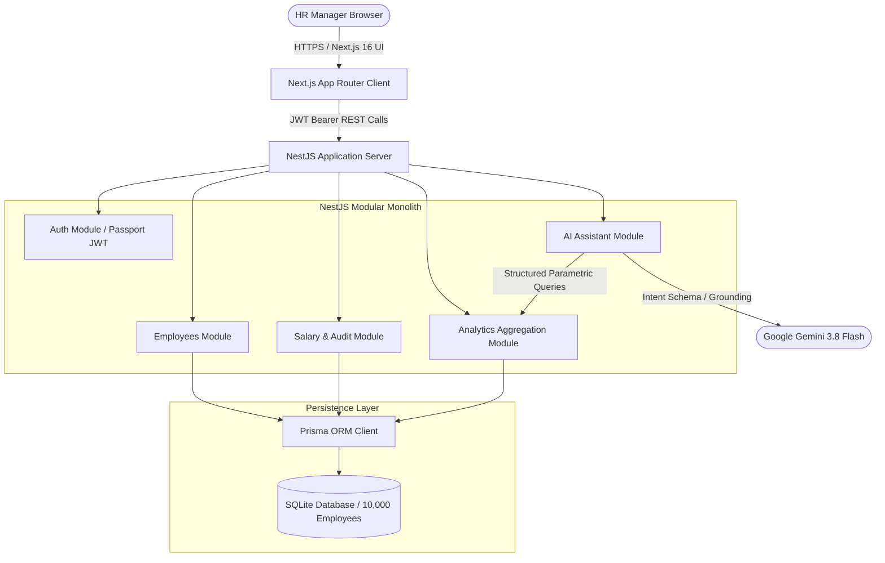
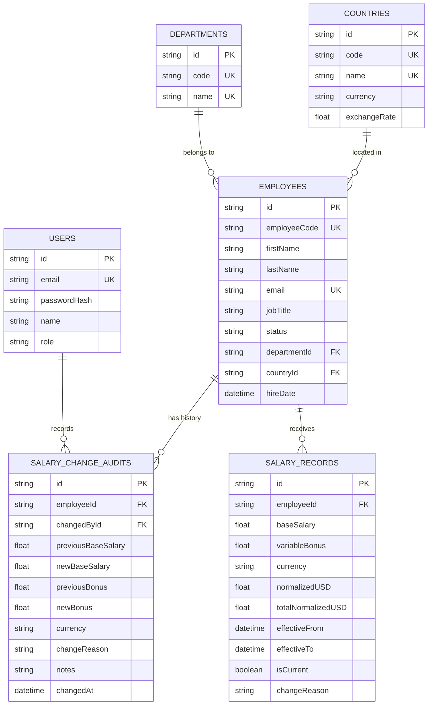
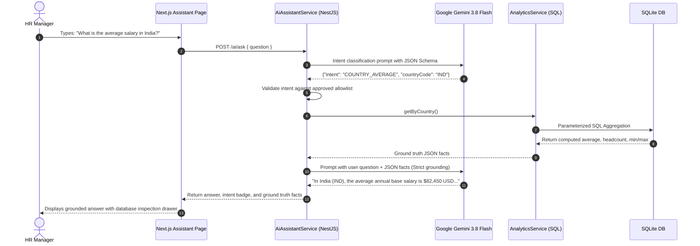

# System Architecture: ACME Salary Management System

## 1. System Overview
The ACME Salary Management System is designed as a high-performance **modular monolith** supporting 10,000 employees distributed across 6 countries and 8 departments. The system provides atomic salary tracking, historical compensation audits, SQL-level aggregate reporting, and an AI conversational salary assistant with strict database query grounding.

---

## 2. Component Responsibilities

### Next.js Frontend (`frontend/`)
* **State & Authentication:** `AuthProvider` with token storage and automatic HTTP 401 interceptors.
* **Dashboard View:** Executive KPI summary cards (headcount, base payroll, average, median, range) and Recharts distribution graphs.
* **Employee Management:** Server-side paginated data table (25 per page), multi-attribute debounce search, filters (department, country, status), and new profile modal.
* **Employee Compensation Timeline:** Historical salary cards, atomic salary revision modal with effective dates and justification, and immutable change audit log.
* **Analytics Explorer:** Country and departmental salary spreads with visual charts.
* **AI Query Assistant:** Natural language query chat with parsed intent badges and expandable SQL JSON fact inspectors.

### NestJS Backend (`backend/`)
* **`AuthModule`:** User password authentication using bcrypt, JWT token signing, and Passport bearer strategy.
* **`EmployeesModule`:** Paginated, filtered, and sorted employee querying over indexed database columns.
* **`SalaryModule`:** Atomic `$transaction` updates closing existing salary records (`isCurrent = false`), creating new active salary records, and appending immutable `SalaryChangeAudit` entries.
* **`AnalyticsModule`:** Real-time SQL aggregations (`COUNT`, `AVG`, `SUM`, `MIN`, `MAX`) computing departmental benchmarks, country pay averages, and salary tier distributions with fixed reporting exchange rates.
* **`AiAssistantModule`:** Safe natural language understanding interface invoking Google Gemini 3.8 Flash with structured JSON schemas and fallbacks to deterministic heuristics. Strictly executes validated SQL services (zero arbitrary SQL execution).

---

## 3. Data Model & Entity Relationships

---

## 4. AI Query Safety & Grounding Flow

